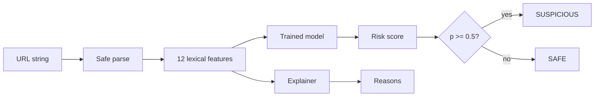

# PhishGuard

A small machine-learning phishing URL detector for email and web security. Python, scikit-learn, fully offline.

## Problem
Phishing links trick people into giving away passwords and money. Blocklists only catch links
that are already known. PhishGuard scores a URL by looking only at its text, so it can flag new
links in milliseconds and tell you why. **It never visits the URL**, so it is safe to run on malicious links.

## How it works


## Features
| # | Feature | # | Feature |
|---|---------|---|---------|
| 1 | url_length | 7 | has_ip_address |
| 2 | hostname_length | 8 | uses_https |
| 3 | num_dots | 9 | num_subdomains |
| 4 | num_hyphens | 10 | path_depth |
| 5 | num_digits | 11 | suspicious_keyword_count |
| 6 | has_at_symbol | 12 | has_suspicious_tld |

## Quick start
```bash
git clone <your-repo-url> && cd phishguard
python -m venv .venv && source .venv/bin/activate   # Windows: .venv\Scripts\activate
pip install -r requirements.txt
make data train test
python -m src.predict "http://secure-login-paypal.verify-account.xyz/signin"
```
No `make` on Windows? Run `python data/build_dataset.py`, `python -m src.train`, `python -m pytest -q`.

## Example output
```
URL: http://secure-login-paypal.verify-account.xyz/signin
Verdict: SUSPICIOUS
Risk score: 1.00
Reasons:
  - Uses HTTP instead of HTTPS
  - Contains 5 suspicious keyword(s) (login, verify, secure)
  - Suspicious top-level domain (.xyz)
  - Many hyphens (3) in the URL
```
Options: `--file urls.txt` (one URL per line) and `--json`.

## Results (held-out test set, 400 URLs)
| Model | Accuracy | Precision | Recall | F1 |
|-------|----------|-----------|--------|----|
| Random Forest | 91.0% | 89.4% | 93.0% | 91.1% |
| **Logistic Regression (selected)** | 92.5% | 92.0% | 93.0% | 92.5% |

ROC AUC 0.933. Average prediction time 0.21 ms per URL.
The best model is chosen automatically by F1, so a re-run may select a different one.
Figures are in `docs/figures/`. See `docs/metrics.json`.

## Project structure
```
src/features.py   feature extraction      src/train.py    training + evaluation
src/predict.py    CLI predictor           src/explain.py  human-readable reasons
data/             dataset generator + notes   tests/    pytest suite (14 tests)
docs/             report, figures, metrics    demo/ presentation/   video link and slides
```

## Measurable objectives
- [x] Extract at least 8 URL features automatically (12 implemented)
- [x] Reach at least 90% accuracy on a held-out test set (92.5%)
- [x] Return a verdict in under 1 second per URL (0.21 ms)
  (scoring time only; a cold `python -m src.predict` start also loads Python and scikit-learn, which adds about 1 s on top)

## Limitations
- **The dataset is synthetic** (see `data/DATA_NOTES.md`), so accuracy is optimistic and does not predict real-world performance.
- Lexical features only: no page content, DNS, WHOIS or certificate checks.
- Attackers can imitate legitimate URL patterns; a short URL hiding behind a redirector looks harmless.
- Decision notes: IP hosts get `num_subdomains = 0`; scheme-less input is treated as HTTP; the model is selected by F1.

## Future work
Train on PhishTank/OpenPhish plus Tranco data, add a browser extension or email plug-in, add
character-level deep learning, combine with domain-age and certificate signals, and retrain on a schedule.

## Security note
PhishGuard performs static string analysis only. It never connects to, fetches or resolves any analysed URL.

## Author
Name, Admission Number, School of Computing Sciences, Riara University

## Licence
MIT
